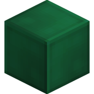
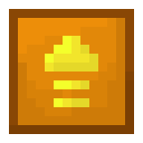
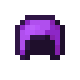

# Heroic Robe Helmet

<figure><figcaption></figcaption></figure>

##  Identifier: <mark style="color:yellow;">**poke\_pfe:heroic\_robe\_helmet**</mark> 

##  Rarity: <mark style="color:yellow;">Common</mark> 

##  Stack Size: <mark style="color:yellow;">1</mark> 

##  Armor: <mark style="color:yellow;">6</mark> 

##  Obtaining: 





<figure><figcaption>
Crafted in the <a href="https://minecraft.wiki/w/Crafting_Table">Crafting Table</a>
</figcaption></figure>

||||
| :-: | :-: | :-: |
|  |  |  |
|  |  |  |
|  |  |  |

Items:

* 5x  [Block of Shade](..\..\blocks\ore-blocks\block-of-shade.md)

*   [Upgrade Core](..\..\items\cores\upgrade-core.md)

* 2x  [Block of Gold](https://minecraft.wiki/w/Block_of_Gold)

*   [Creedite Helmet](creedite-helmet.md)

Outputs:

*   [Heroic Robe Helmet](heroic-robe-helmet.md)

Recipe can be unlocked with:

*  [Creedite Helmet](creedite-helmet.md)





This page was generated automatically (NOT BY AI). there may be some broken links or improperly formatted information while I continue to develop this tool
