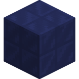
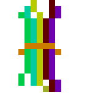
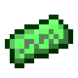
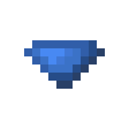
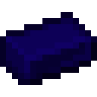

# Barometer

<figure><figcaption></figcaption></figure>

##  Identifier: <mark style="color:yellow;">**poke\_pfe:barometer**</mark> 

##  Rarity: <mark style="color:yellow;">Common</mark> 

##  Stack Size: <mark style="color:yellow;">64</mark> 

##  Note Sound: <mark style="color:yellow;">Bass Drum</mark>

##  Map Color: <mark style="color:yellow;">#7a5a0f</mark> <mark style="color:$info;">(hex)</mark>

##  Preferred Tool: <mark style="color:yellow;">ERROR</mark>

* &#x20;Time to break with preferred tool (baseline): <mark style="color:yellow;">0</mark>
* Time to break by hand: <mark style="color:yellow;">1 second</mark>

##  Obtaining: 





<figure><figcaption>
Crafted in the <a href="https://minecraft.wiki/w/Crafting_Table">Crafting Table</a>
</figcaption></figure>

||||
| :-: | :-: | :-: |
|  |  |  |
|  |  |  |
|  |  |  |

Items:

* 4x  [Cut Cobalt](..\cut-blocks\cut-cobalt.md)

*   [Wire](..\..\items\crafting-components\wire.md)

* 2x  [Electric Component](..\..\items\crafting-components\electric-component.md)

*   [Rain Gem](..\..\items\gems\rain-gem.md)

*   [Daylight Detector](https://minecraft.wiki/w/Daylight_Detector)

Outputs:

* undefinedx  [Barometer](barometer.md)

Recipe can be unlocked with:

*  [Cobalt Ingot](..\..\items\ingots\cobalt-ingot.md)

*  [Cut Cobalt](..\cut-blocks\cut-cobalt.md)

*  [Wire](..\..\items\crafting-components\wire.md)

*  [Rain Gem](..\..\items\gems\rain-gem.md)

*  [Electric Component](..\..\items\crafting-components\electric-component.md)

*  [Daylight Detector](https://minecraft.wiki/w/Daylight_Detector)





This page was generated automatically (NOT BY AI). there may be some broken links or improperly formatted information while I continue to develop this tool
