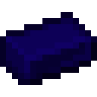
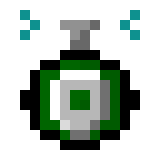
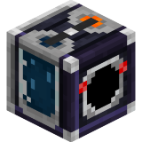

# Dirter

<figure><figcaption></figcaption></figure>

##  Identifier: <mark style="color:yellow;">**poke\_pfe:dirter**</mark> 

##  Rarity: <mark style="color:yellow;">Common</mark> 

##  Stack Size: <mark style="color:yellow;">64</mark> 

##  Note Sound: <mark style="color:yellow;">Bass Drum</mark>

##  Map Color: <mark style="color:yellow;">#22222f</mark> <mark style="color:$info;">(hex)</mark>

##  Preferred Tool: <mark style="color:yellow;">Axe</mark>

* &#x20;Time to break with preferred tool (baseline): <mark style="color:yellow;">1.25 seconds</mark>
* Time to break by hand: <mark style="color:yellow;">5 seconds</mark>

##  Obtaining: 





<figure><figcaption>
Crafted in the <a href="https://minecraft.wiki/w/Crafting_Table">Crafting Table</a>
</figcaption></figure>

||||
| :-: | :-: | :-: |
|  |  |  |
|  |  |  |
|  |  |  |

Items:

* 4x  [Cobalt Ingot](..\..\items\ingots\cobalt-ingot.md)

*   [Cobblestone](https://minecraft.wiki/w/Cobblestone)

*   [GPS Module](..\..\items\crafting-components\gps-module.md)

*   [Dirt](https://minecraft.wiki/w/Dirt)

Outputs:

*   [Dirter](dirter.md)

Recipe can be unlocked with:

*  [Cobblestone Generator](cobblestone-generator.md)

*  [Cobalt Ingot](..\..\items\ingots\cobalt-ingot.md)

*  [GPS Module](..\..\items\crafting-components\gps-module.md)

*  [Cobblestone](https://minecraft.wiki/w/Cobblestone)

*  [Dirt](https://minecraft.wiki/w/Dirt)





This page was generated automatically (NOT BY AI). there may be some broken links or improperly formatted information while I continue to develop this tool
