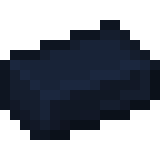
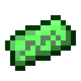

# Flash Freezer

<figure><figcaption></figcaption></figure>

##  Identifier: <mark style="color:yellow;">**poke\_pfe:flash\_freezer**</mark> 

##  Rarity: <mark style="color:yellow;">Common</mark> 

##  Stack Size: <mark style="color:yellow;">64</mark> 

##  Note Sound: <mark style="color:yellow;">Bass Drum</mark>

##  Map Color: <mark style="color:yellow;">#d4dff7</mark> <mark style="color:$info;">(hex)</mark>

##  Preferred Tool: <mark style="color:yellow;">ERROR</mark>

* &#x20;Time to break with preferred tool (baseline): <mark style="color:yellow;">0</mark>
* Time to break by hand: <mark style="color:yellow;">1 second</mark>

##  Obtaining: 





<figure><figcaption>
Crafted in the <a href="https://minecraft.wiki/w/Crafting_Table">Crafting Table</a>
</figcaption></figure>

||||
| :-: | :-: | :-: |
|  |  |  |
|  |  |  |
|  |  |  |

Items:

* 4x  [Iron Ingot](https://minecraft.wiki/w/Iron_Ingot)

* 2x  [Onyx Ingot](..\..\items\ingots\onyx-ingot.md)

*   [Redstone Dust](https://minecraft.wiki/w/Redstone_Dust)

*   [Electric Component](..\..\items\crafting-components\electric-component.md)

*   [Blue Ice](https://minecraft.wiki/w/Blue_Ice)

Outputs:

* undefinedx  [Flash Freezer](flash-freezer.md)

Recipe can be unlocked with:

*  [Iron Ingot](https://minecraft.wiki/w/Iron_Ingot)

*  [Redstone Dust](https://minecraft.wiki/w/Redstone_Dust)

*  [Ice](https://minecraft.wiki/w/Ice)

*  [Packed Ice](https://minecraft.wiki/w/Packed_Ice)

*  [Blue Ice](https://minecraft.wiki/w/Blue_Ice)

*  [Onyx Ingot](..\..\items\ingots\onyx-ingot.md)

*  [Electric Component](..\..\items\crafting-components\electric-component.md)





This page was generated automatically (NOT BY AI). there may be some broken links or improperly formatted information while I continue to develop this tool
