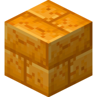
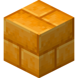

# Cracked Honey Bricks

<figure><figcaption></figcaption></figure>

##  Identifier: <mark style="color:yellow;">**poke\_pfe:cracked\_honey\_bricks**</mark> 

##  Rarity: <mark style="color:yellow;">Common</mark> 

##  Stack Size: <mark style="color:yellow;">64</mark> 

##  Note Sound: <mark style="color:yellow;">Bass Drum</mark>

##  Map Color: <mark style="color:yellow;">#1602c7</mark> <mark style="color:$info;">(hex)</mark>

##  Preferred Tool: <mark style="color:yellow;">Pickaxe</mark>

* &#x20;Time to break with preferred tool (baseline): <mark style="color:yellow;">1.15 seconds</mark>
* Time to break by hand: <mark style="color:yellow;">7.5 seconds</mark>

##  Obtaining: 





<figure><figcaption>
Smelted in a <a href="https://minecraft.wiki/w/Furnace">Furnace</a>
</figcaption></figure> <figure><figcaption>
Smelted in a <a href="https://minecraft.wiki/w/Blast_Furnace">Blast Furnace</a>
</figcaption></figure>

<table><thead><tr><th>Input</th><th>Output</th><th data-type="number">Amount</th></tr></thead><tbody><tr><td> <a href="cracked-honey-bricks.md">Honey Bricks</a></td><td> Cracked Honey Bricks</td><td>1</td></tr></tbody></table>





This page was generated automatically (NOT BY AI). there may be some broken links or improperly formatted information while I continue to develop this tool
