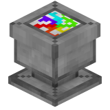
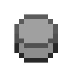
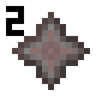
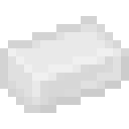
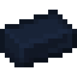
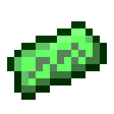
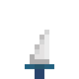
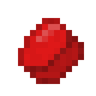

# Dye Unmixer

<figure><figcaption></figcaption></figure>

##  Identifier: <mark style="color:yellow;">**poke\_pfe:dye\_unmixer**</mark> 

##  Rarity: <mark style="color:yellow;">Common</mark> 

##  Stack Size: <mark style="color:yellow;">64</mark> 

##  Note Sound: <mark style="color:yellow;">Bass Drum</mark>

##  Map Color: <mark style="color:yellow;">#697c79</mark> <mark style="color:$info;">(hex)</mark>

##  Preferred Tool: <mark style="color:yellow;">ERROR</mark>

* &#x20;Time to break with preferred tool (baseline): <mark style="color:yellow;">0</mark>
* Time to break by hand: <mark style="color:yellow;">1.4 seconds</mark>

##  Obtaining: 





<figure><figcaption>
Crafted in the <a href="https://minecraft.wiki/w/Crafting_Table">Crafting Table</a>
</figcaption></figure>

||||
| :-: | :-: | :-: |
|  |  |  |
|  |  |  |
|  |  |  |

Items:

* 2x  [Plastic](..\..\items\crafting-components\plastic.md)

*   ERROR (poke_pfe:banished_star_x2)

* 2x  [Holy Ingot](..\..\items\ingots\holy-ingot.md)

*   [Cauldron](https://minecraft.wiki/w/Cauldron)

* 2x  [Onyx Ingot](..\..\items\ingots\onyx-ingot.md)

*   [Electric Component](..\..\items\crafting-components\electric-component.md)

Outputs:

*   [Dye Unmixer](dye-unmixer.md)

Recipe can be unlocked with:

*  [Pocket Knife](..\..\weapons\swords\pocket-knife.md)

*  [Plastic](..\..\items\crafting-components\plastic.md)

*  [Electric Component](..\..\items\crafting-components\electric-component.md)

*  [Armor Stand](https://minecraft.wiki/w/Armor_Stand)

*  [Red Button](..\..\items\crafting-components\red-button.md)





This page was generated automatically (NOT BY AI). there may be some broken links or improperly formatted information while I continue to develop this tool
