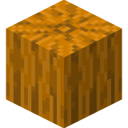
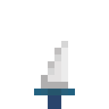
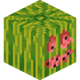
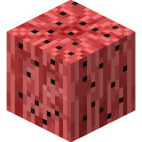

# Gilded Melon

<figure><figcaption></figcaption></figure>

##  Identifier: <mark style="color:yellow;">**poke\_pfe:gilded\_melon**</mark> 

##  Rarity: <mark style="color:yellow;">Common</mark> 

##  Stack Size: <mark style="color:yellow;">64</mark> 

##  Note Sound: <mark style="color:yellow;">Bass Drum</mark>

##  Map Color: <mark style="color:yellow;">#df982e</mark> <mark style="color:$info;">(hex)</mark>

##  Preferred Tool: <mark style="color:yellow;">ERROR</mark>

* &#x20;Time to break with preferred tool (baseline): <mark style="color:yellow;">0</mark>
* Time to break by hand: <mark style="color:yellow;">1.5 seconds</mark>

##  Obtaining: 





<figure><figcaption>
Crafted in the <a href="https://minecraft.wiki/w/Crafting_Table">Crafting Table</a>
</figcaption></figure>

||||
| :-: | :-: | :-: |
|  |  |  |
|  |  |  |
|  |  |  |

Items:

* 4x  [Gold Nugget](https://minecraft.wiki/w/Gold_Nugget)

* 4x  [Gold Ingot](https://minecraft.wiki/w/Gold_Ingot)

*   [Melon Block](https://minecraft.wiki/w/Melon)

Outputs:

* undefinedx  [Gilded Melon](gilded-melon.md)

Recipe can be unlocked with:

*  [Melon Block](https://minecraft.wiki/w/Melon)

*  [Melon Slice](https://minecraft.wiki/w/Melon_Slice)

*  [Melon Seeds](https://minecraft.wiki/w/Melon_Seeds)

*  [Pocket Knife](..\..\weapons\swords\pocket-knife.md)

*  [Carved Melon](carved-melon.md)

*  [Gilded Carved Melon](carved-gilded-melon.md)

*  [Carved Carved Melon](carved-carved-melon.md)





This page was generated automatically (NOT BY AI). there may be some broken links or improperly formatted information while I continue to develop this tool
