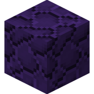

# Cobbled Shadowstone

<figure><figcaption></figcaption></figure>

##  Identifier: <mark style="color:yellow;">**poke\_pfe:cobbled\_shadowstone**</mark> 

##  Rarity: <mark style="color:yellow;">Common</mark> 

##  Stack Size: <mark style="color:yellow;">64</mark> 

##  Note Sound: <mark style="color:yellow;">Bass Drum</mark>

##  Map Color: <mark style="color:yellow;">#2a1d2c</mark> <mark style="color:$info;">(hex)</mark>

##  Preferred Tool: <mark style="color:yellow;">Pickaxe</mark>

* &#x20;Time to break with preferred tool (baseline): <mark style="color:yellow;">1.15 seconds</mark>
* Time to break by hand: <mark style="color:yellow;">7.5 seconds</mark>

This page was generated automatically (NOT BY AI). there may be some broken links or improperly formatted information while I continue to develop this tool
