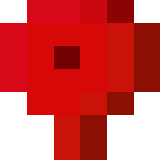

# Lava Sponge

<figure><figcaption></figcaption></figure>

##  Identifier: <mark style="color:yellow;">**poke\_pfe:lava\_sponge**</mark> 

##  Rarity: <mark style="color:yellow;">Common</mark> 

##  Stack Size: <mark style="color:yellow;">64</mark> 

##  Note Sound: <mark style="color:yellow;">Bass Drum</mark>

##  Map Color: <mark style="color:yellow;">#e25f22</mark> <mark style="color:$info;">(hex)</mark>

This page was generated automatically (NOT BY AI). there may be some broken links or improperly formatted information while I continue to develop this tool
