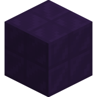
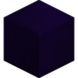

# Cut Astral Stairs

<figure><figcaption></figcaption></figure>

##  Identifier: <mark style="color:yellow;">**poke\_pfe:cut\_astral\_stairs**</mark> 

##  Rarity: <mark style="color:yellow;">Common</mark> 

##  Obtaining: 



<figure><figcaption>
Cut with the <a href="https://minecraft.wiki/w/Stonecutter">Stonecutter</a>
</figcaption></figure>

<table><thead><tr><th>Input</th><th>Output</th><th data-type="number">Amount</th></tr></thead><tbody><tr><td> <a href="..\cut-blocks\cut-astral.md">Cut Astral</a></td><td> Cut Astral Stairs</td><td>1</td></tr></tbody></table>



<figure><figcaption>
Cut with the <a href="https://minecraft.wiki/w/Stonecutter">Stonecutter</a>
</figcaption></figure>

<table><thead><tr><th>Input</th><th>Output</th><th data-type="number">Amount</th></tr></thead><tbody><tr><td> <a href="..\ore-blocks\block-of-astral.md">Astral Block</a></td><td> Cut Astral Stairs</td><td>4</td></tr></tbody></table>




This page was generated automatically (NOT BY AI). there may be some broken links or improperly formated information while I continue to develop this tool
