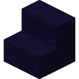
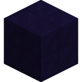
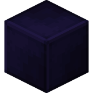

# Cut Onyx Stairs

<figure><figcaption></figcaption></figure>

##  Identifier: <mark style="color:yellow;">**poke\_pfe:cut\_onyx\_stairs**</mark> 

##  Rarity: <mark style="color:yellow;">Common</mark> 

##  Stack Size: <mark style="color:yellow;">64</mark> 

##  Note Sound: <mark style="color:yellow;">Trumpet</mark>

##  Map Color: <mark style="color:yellow;">#7d7d7d</mark> <mark style="color:$info;">(hex)</mark>

##  Preferred Tool: <mark style="color:yellow;">ERROR</mark>

* &#x20;Time to break with preferred tool (baseline): <mark style="color:yellow;">0</mark>
* Time to break by hand: <mark style="color:yellow;">7.5 seconds</mark>

##  Obtaining: 





<figure><figcaption>
Crafted in the <a href="https://minecraft.wiki/w/Crafting_Table">Crafting Table</a>
</figcaption></figure>

||||
| :-: | :-: | :-: |
|  |  |  |
|  |  |  |
|  |  |  |

Items:

* 6x  [Cut Onyx](..\cut-blocks\cut-onyx.md)

Outputs:

* 4x  [Cut Onyx Stairs](cut-onyx-stairs.md)

Recipe can be unlocked with:

*  [Cut Onyx](..\cut-blocks\cut-onyx.md)




<figure><figcaption>
Cut with the <a href="https://minecraft.wiki/w/Stonecutter">Stonecutter</a>
</figcaption></figure>

<table><thead><tr><th>Input</th><th>Output</th><th data-type="number">Amount</th></tr></thead><tbody><tr><td> <a href="..\cut-blocks\cut-onyx.md">Cut Onyx</a></td><td> Cut Onyx Stairs</td><td>1</td></tr></tbody></table>



<figure><figcaption>
Cut with the <a href="https://minecraft.wiki/w/Stonecutter">Stonecutter</a>
</figcaption></figure>

<table><thead><tr><th>Input</th><th>Output</th><th data-type="number">Amount</th></tr></thead><tbody><tr><td> <a href="">Block of Onyx</a></td><td> Cut Onyx Stairs</td><td>4</td></tr></tbody></table>




This page was generated automatically (NOT BY AI). there may be some broken links or improperly formatted information while I continue to develop this tool
