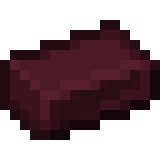
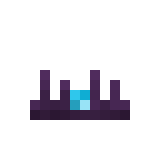
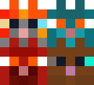
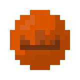
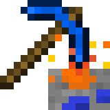
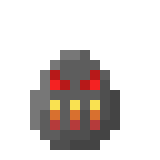
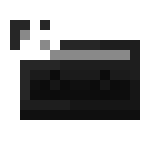
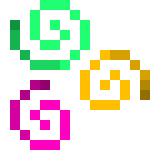

# v1.3.05

## Download Links:

### GitHub:

### CurseForge:




This was made for Minecraft Version: <mark style="color:yellow;">26.60</mark>

No experimental toggles are required


##  **Items & Armor** 

### Added [Cassette: Bounce](../../../items/cassettes/music-disc-cassettes/cassette-bounce.md)

### Added [Cassette: Ebb](../../../items/cassettes/minecraft-music-cassettes/cassette-ebb.md)

### Added [Cassette: Home](../../../items/cassettes/minecraft-music-cassettes/cassette-home.md)

### Added [Cassette: Memories](../../../items/cassettes/minecraft-music-cassettes/cassette-memories.md)

### Added [Cassette: Nightly](../../../items/cassettes/minecraft-music-cassettes/cassette-nightly.md)

### Added [Cassette: Shores](../../../items/cassettes/minecraft-music-cassettes/cassette-shores.md)

## <picture><source srcset="https://github.com/ItsMePok/PFE/blob/wikiAssets/blockRenders/CobbledLimestone.png?raw=true" media="(prefers-color-scheme: dark)"></picture> **Blocks & Ores** <picture><source srcset="https://github.com/ItsMePok/PFE/blob/wikiAssets/ore/cobaltOre.png?raw=true" media="(prefers-color-scheme: dark)"></picture>

### Added Stair variants for all the PFE blocks that currently have a slab variant:

* Raw Galaxy Stairs
* Raw Astral Stairs
* Raw Hellish Stairs
* Raw Nebula Stairs
* Raw Demonic Stairs
* Nebula Brick Stairs
* Cut Holy Stairs
* Raw Godly Stairs
* Void Brick Stairs
* Raw Cobalt Stairs
* Raw Holy Stairs
* Raw Shade Stairs
* Raw Onyx Stairs
* Smooth Limestone Stairs
* Shadowstone Stairs
* Shade Brick Stairs
* Radium Brick Stairs
* Polished Shadowstone Stairs
* Galaxy Brick Stairs
* Onyx Brick Stairs
* Molten Brick Stairs
* Medic Brick Stairs
* Limestone Brick Stairs
* Honey Tile Stairs
* Holy Brick Stairs
* Hellish Brick Stairs
* Godly Brick Stairs
* Demonic Brick Stairs
* Death Brick Stairs
* Cut Void Stairs
* Cut Shade Stairs
* Cut Radium Stairs
* Cut Onyx Stairs
* Cut Hellish Stairs
* Cut Nebula Stairs
* Cut Molten Stairs
* Cut Medic Stairs
* Cut Astral Stairs
* Cut Godly Stairs
* Cut Galaxy Stairs
* Cut Demonic Stairs
* Cut Death Stairs
* Cut Cobalt Stairs
* Cobbled Shadowstone Stairs
* Cobbled Limestone Stairs
* Cobalt Brick Stairs
* Chiseled Cobalt Stairs
* Beveled Limestone Stairs
* Astral Brick Stairs&#x20;

##  **Mobs & Trades** 

##  **Balancing** 

##  **Recipes** 

### Recipes in the Upgrader have been grouped together based on their material type

##  **Textures & Sounds** <picture><source srcset="https://github.com/ItsMePok/PFE/blob/wikiAssets/cassette/cassette_mc_disc_cat.png?raw=true" media="(prefers-color-scheme: dark)"></picture>

##  Structures & Other 

##  **Bug Fixes** 

### Fixed an issue where some items were not properly sorted in the creative menu

##  **Technical Changes** 

### Updated format versions to 1.26.60

### Updated @minecraft/server to 2.11.0

### Updated @minecraft/server-ui to 2.3.0

### Added field: group to items in poke\_pfe:custom\_recipes

* This is a translation string that is subsequently used as a identifier for the group.
* Recipes will be grouped together based on this identifier when. This allows for easier navigation when there are a significant amount of recipes available in the custom crafting menu
