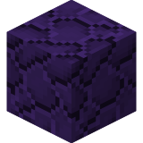
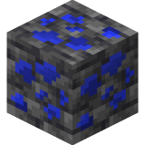

# v1.3.05

## Download Links:

### GitHub:



### CurseForge:




This was made for Minecraft Version: <mark style="color:yellow;">26.60</mark>

No experimental toggles are required


##  **Items & Armor** 

### Added [Cassette: Bounce](../../../items/cassettes/music-disc-cassettes/cassette-bounce.md)

### Added [Cassette: Ebb](../../../items/cassettes/minecraft-music-cassettes/cassette-ebb.md)

### Added [Cassette: Home](../../../items/cassettes/minecraft-music-cassettes/cassette-home.md)

### Added [Cassette: Memories](../../../items/cassettes/minecraft-music-cassettes/cassette-memories.md)

### Added [Cassette: Nightly](../../../items/cassettes/minecraft-music-cassettes/cassette-nightly.md)

### Added [Cassette: Shores](../../../items/cassettes/minecraft-music-cassettes/cassette-shores.md)

## <picture><source srcset="https://github.com/ItsMePok/PFE/blob/wikiAssets/blockRenders/CobbledLimestone.png?raw=true" media="(prefers-color-scheme: dark)"></picture> **Blocks & Ores** <picture><source srcset="https://github.com/ItsMePok/PFE/blob/wikiAssets/ore/cobaltOre.png?raw=true" media="(prefers-color-scheme: dark)"></picture>

### Added Stair variants for all the PFE blocks that currently have a slab variant:

* [Raw Galaxy Stairs](../../../blocks/stairs/raw-galaxy-stairs.md)
* [Raw Astral Stairs](../../../blocks/stairs/raw-astral-stairs.md)
* [Raw Hellish Stairs](../../../blocks/stairs/raw-hellish-stairs.md)
* [Raw Nebula Stairs](../../../blocks/stairs/raw-nebula-stairs.md)
* [Raw Demonic Stairs](../../../blocks/stairs/raw-demonic-stairs.md)
* [Nebula Brick Stairs](../../../blocks/stairs/nebula-brick-stairs.md)
* [Cut Holy Stairs](../../../blocks/stairs/cut-holy-stairs.md)
* [Raw Godly Stairs](../../../blocks/stairs/raw-godly-stairs.md)
* [Void Brick Stairs](../../../blocks/stairs/void-brick-stairs.md)
* [Raw Cobalt Stairs](../../../blocks/stairs/raw-cobalt-stairs.md)
* [Raw Holy Stairs](../../../blocks/stairs/raw-holy-stairs.md)
* [Raw Shade Stairs](../../../blocks/stairs/raw-shade-stairs.md)
* [Raw Onyx Stairs](../../../blocks/stairs/raw-onyx-stairs.md)
* [Smooth Limestone Stairs](../../../blocks/stairs/smooth-limestone-stairs.md)
* [Shadowstone Stairs](../../../blocks/stairs/shadowstone-stairs.md)
* [Shade Brick Stairs](../../../blocks/stairs/shade-brick-stairs.md)
* [Radium Brick Stairs](../../../blocks/stairs/radium-brick-stairs.md)
* [Polished Shadowstone Stairs](../../../blocks/stairs/polished-shadowstone-stairs.md)
* [Galaxy Brick Stairs](../../../blocks/stairs/galaxy-brick-stairs.md)
* [Onyx Brick Stairs](../../../blocks/stairs/onyx-brick-stairs.md)
* [Molten Brick Stairs](../../../blocks/stairs/molten-brick-stairs.md)
* [Medic Brick Stairs](../../../blocks/stairs/medic-brick-stairs.md)
* [Limestone Brick Stairs](../../../blocks/stairs/limestone-brick-stairs.md)
* Honey Tile Stairs
* [Holy Brick Stairs](../../../blocks/stairs/holy-brick-stairs.md)
* [Hellish Brick Stairs](../../../blocks/stairs/hellish-brick-stairs.md)
* [Godly Brick Stairs](../../../blocks/stairs/godly-brick-stairs.md)
* [Demonic Brick Stairs](../../../blocks/stairs/demonic-brick-stairs.md)
* [Death Brick Stairs](../../../blocks/stairs/death-brick-stairs.md)
* [Cut Void Stairs](../../../blocks/stairs/cut-void-stairs.md)
* [Cut Shade Stairs](../../../blocks/stairs/cut-shade-stairs.md)
* [Cut Radium Stairs](../../../blocks/stairs/cut-radium-stairs.md)
* [Cut Onyx Stairs](../../../blocks/stairs/cut-onyx-stairs.md)
* [Cut Hellish Stairs](../../../blocks/stairs/cut-hellish-stairs.md)
* [Cut Nebula Stairs](../../../blocks/stairs/cut-nebula-stairs.md)
* [Cut Molten Stairs](../../../blocks/stairs/cut-molten-stairs.md)
* [Cut Medic Stairs](../../../blocks/stairs/cut-medic-stairs.md)
* [Cut Astral Stairs](../../../blocks/stairs/cut-astral-stairs.md)
* [Cut Godly Stairs](../../../blocks/stairs/cut-godly-stairs.md)
* [Cut Galaxy Stairs](../../../blocks/stairs/cut-galaxy-stairs.md)
* [Cut Demonic Stairs](../../../blocks/stairs/cut-demonic-stairs.md)
* [Cut Death Stairs](../../../blocks/stairs/cut-death-stairs.md)
* [Cut Cobalt Stairs](../../../blocks/stairs/cut-cobalt-stairs.md)
* [Cobbled Shadowstone Stairs](../../../blocks/stairs/cobbled-shadowstone-stairs.md)
* [Cobbled Limestone Stairs](../../../blocks/stairs/cobbled-limestone-stairs.md)
* [Cobalt Brick Stairs](../../../blocks/stairs/cobalt-brick-stairs.md)
* [Chiseled Cobalt Stairs](../../../blocks/stairs/chiseled-cobalt-stairs.md)
* [Beveled Limestone Stairs](../../../blocks/stairs/beveled-limestone-stairs.md)
* [Astral Brick Stairs ](../../../blocks/stairs/astral-brick-stairs.md)

##  **Recipes** 

### Recipes in the [Upgrader](../../../blocks/crafters/upgrader.md) have been grouped together based on their material type

##  **Bug Fixes** 

### Fixed an issue where some items were not properly sorted in the creative menu

##  **Technical Changes** 

### Updated format versions to 1.26.60

### Updated @minecraft/server to 2.11.0

### Updated @minecraft/server-ui to 2.3.0

### Added field: group to items in poke\_pfe:custom\_recipes

* This is a translation string that is subsequently used as a identifier for the group.
* Recipes will be grouped together based on this identifier when. This allows for easier navigation when there are a significant amount of recipes available in the custom crafting menu

### Moved some of the block recipe files so that they are now grouped by material type
