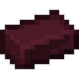
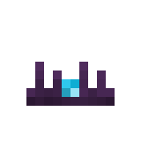
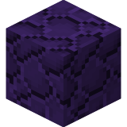
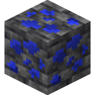
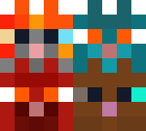
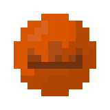
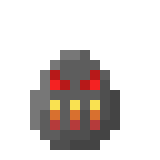
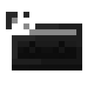
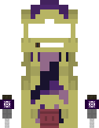

# v1.3.06

## Download Links:

### GitHub:

### CurseForge:




This was made for Minecraft Version: <mark style="color:yellow;">1.21.93</mark>

No experimental toggles are required


##  **Items & Armor** 

## <picture><source srcset="https://github.com/ItsMePok/PFE/blob/wikiAssets/blockRenders/CobbledLimestone.png?raw=true" media="(prefers-color-scheme: dark)"></picture> **Blocks & Ores** <picture><source srcset="https://github.com/ItsMePok/PFE/blob/wikiAssets/ore/cobaltOre.png?raw=true" media="(prefers-color-scheme: dark)"></picture>

##  **Mobs & Trades** 

##  **Balancing** 

##  **Recipes** 

##  **Textures & Sounds** <picture><source srcset="https://github.com/ItsMePok/PFE/blob/wikiAssets/cassette/cassette_mc_disc_cat.png?raw=true" media="(prefers-color-scheme: dark)"></picture>

##  Structures & Other 

##  **Bug Fixes** 

### [Raw Void Stairs](../../../blocks/stairs/raw-void-stairs.md) now have their crafting recipes

##  **Technical Changes** 

### Changed the Identifier of the Golden Gem Holder: poke_pfe:gem_holder -> poke_pfe:golden_gem_holder

### Changed the Identifier of the Furnace Golem Spawn Egg (Survival Variant): poke_pfe:furnace_golem -> poke_pfe:spawn_furnace_golem

### Changed the Identifier of the Furnace Golem: poke_pfe:robo_golem -> poke_pfe:furnace_golem

### Changed the Identifier of the Money Man Spawn Egg (Survival Variant): poke_pfe:money_man -> poke_pfe:spawn_money_man

## Removed comments from all block, item, and recipe files

## Wiki Changes:

### Begun Automating the creation of wiki pages:
  - This currently affects only block and item pages. I am working to expand the amount of content on each page over these next few weeks
  - Some information that was previously available on some pages may be temporarily missing while i go through and add each thing to the tool.
  - Please let me know in the discord if you have any feedback/suggestions