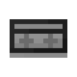
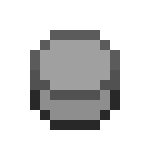
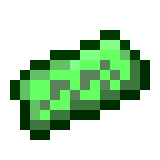

# Empty Cassette

<figure><figcaption></figcaption></figure>

##  Identifier: <mark style="color:yellow;">**poke\_pfe:empty\_cassette**</mark> 

##  Rarity: <mark style="color:yellow;">Common</mark> 

##  Stack Size: <mark style="color:yellow;">64</mark> 

##  Obtaining: 





<figure><figcaption>
Crafted in the <a href="https://minecraft.wiki/w/Crafting_Table">Crafting Table</a>
</figcaption></figure>

||||
| :-: | :-: | :-: |
|  |  |  |
|  |  |  |
|  |  |  |

Items:

* 7x  [Plastic](..\crafting-components\plastic.md)

* 2x  [Electric Component](..\crafting-components\electric-component.md)

Outputs:

*   [Empty Cassette](empty-cassette.md)

Recipe can be unlocked with:

*  [Plastic](..\crafting-components\plastic.md)

*  [Electric Component](..\crafting-components\electric-component.md)

*  [Music Disc - Ward](https://minecraft.wiki/w/Music_Disc_ward)

*  [Music Disc - 13](https://minecraft.wiki/w/Music_Disc_13)

*  [Music Disc - Wait](https://minecraft.wiki/w/Music_Disc_wait)

*  [Music Disc - Strad](https://minecraft.wiki/w/Music_Disc_strad)

*  [Music Disc - Stal](https://minecraft.wiki/w/Music_Disc_stal)

*  [Music Disc - Relic](https://minecraft.wiki/w/Music_Disc_Relic)

*  [Music Disc - Pigstep](https://minecraft.wiki/w/Music_Disc_Pigstep)

*  [Music Disc - Otherside](https://minecraft.wiki/w/Music_Disc_otherside)

*  [Music Disc - Mellohi](https://minecraft.wiki/w/Music_Disc_mellohi)

*  [Music Disc - Mall](https://minecraft.wiki/w/Music_Disc_mall)

*  [Music Disc - Far](https://minecraft.wiki/w/Music_Disc_far)

*  [Music Disc - Chirp](https://minecraft.wiki/w/Music_Disc_chirp)

*  [Music Disc - Cat](https://minecraft.wiki/w/Music_Disc_cat)

*  [Music Disc - Blocks](https://minecraft.wiki/w/Music_Disc_blocks)

*  [Music Disc - 11](https://minecraft.wiki/w/Music_Disc_11)

*  [Music Disc - 5](https://minecraft.wiki/w/Music_Disc_5)

*  [Disk Fragment](https://minecraft.wiki/w/Disc_Fragment)





This page was generated automatically (NOT BY AI). there may be some broken links or improperly formatted information while I continue to develop this tool
