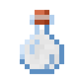

# Cheese

<figure><figcaption></figcaption></figure>

##  Identifier: <mark style="color:yellow;">**poke\_pfe:cheese**</mark> 

##  Rarity: <mark style="color:yellow;">Common</mark> 

##  Stack Size: <mark style="color:yellow;">64</mark> 

##  Obtaining: 





<figure><figcaption>
Smelted in a <a href="https://minecraft.wiki/w/Furnace">Furnace</a>
</figcaption></figure> <figure><figcaption>
Smoked in a <a href="https://minecraft.wiki/w/Smoker}">Smoker</a>
</figcaption></figure> <figure><figcaption>
Cooked on a <a href="https://minecraft.wiki/w/Campfire">Campfire</a>
</figcaption></figure> <figure><figcaption>
Cooked on a <a href="https://minecraft.wiki/w/Soul_Campfire">Soul Campfire</a>
</figcaption></figure>

<table><thead><tr><th>Input</th><th>Output</th><th data-type="number">Amount</th></tr></thead><tbody><tr><td> <a href="milk-bottle.md">Milk Bottle</a></td><td> Cheese</td><td>1</td></tr></tbody></table>





This page was generated automatically (NOT BY AI). there may be some broken links or improperly formatted information while I continue to develop this tool
