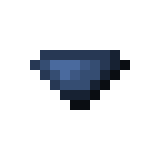
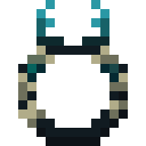

# Darkness Gem

<figure><figcaption></figcaption></figure>

##  Identifier: <mark style="color:yellow;">**poke\_pfe:darkness\_gem**</mark> 

##  Rarity: <mark style="color:yellow;">Common</mark> 

##  Stack Size: <mark style="color:yellow;">64</mark> 

##  Obtaining: 





<figure><figcaption>
Crafted in the <a href="https://minecraft.wiki/w/Crafting_Table">Crafting Table</a>
</figcaption></figure>

||||
| :-: | :-: | :-: |
|  |  |  |
|  |  |  |
|  |  |  |

Items:

* 4x  [Sculk Sensor](https://minecraft.wiki/w/Sculk_Sensor)

* 4x  [Echo Shard](https://minecraft.wiki/w/Echo_Shard)

*   [Sculk Shrieker](https://minecraft.wiki/w/Sculk_Shrieker)

Outputs:

*   [Darkness Gem](darkness-gem.md)

Recipe can be unlocked with:

*  [Echo Holder](..\gem-holders\echo-holder.md)





This page was generated automatically (NOT BY AI). there may be some broken links or improperly formatted information while I continue to develop this tool
