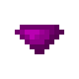
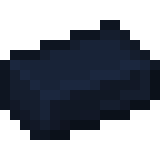

# Dragon Gem

<figure><figcaption></figcaption></figure>

##  Identifier: <mark style="color:yellow;">**poke\_pfe:dragon\_gem**</mark> 

##  Rarity: <mark style="color:yellow;">Common</mark> 

##  Stack Size: <mark style="color:yellow;">64</mark> 

##  Obtaining: 





<figure><figcaption>
Crafted in the <a href="https://minecraft.wiki/w/Crafting_Table">Crafting Table</a>
</figcaption></figure>

||||
| :-: | :-: | :-: |
|  |  |  |
|  |  |  |
|  |  |  |

Items:

* 4x  [Elytra](https://minecraft.wiki/w/Elytra)

* 4x  [Onyx Ingot](..\ingots\onyx-ingot.md)

*   [Block of Netherite](https://minecraft.wiki/w/Block_of_Netherite)

Outputs:

* 1x  [Dragon Gem](dragon-gem.md)

Recipe can be unlocked with:

*  [Golden Gem Holder](..\gem-holders\golden-gem-holder.md)





This page was generated automatically (NOT BY AI). there may be some broken links or improperly formatted information while I continue to develop this tool
