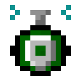
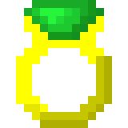
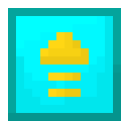
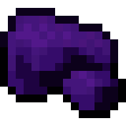

# Gravity Gem

<figure><figcaption></figcaption></figure>

##  Identifier: <mark style="color:yellow;">**poke\_pfe:gravity\_gem**</mark> 

##  Rarity: <mark style="color:yellow;">Common</mark> 

##  Stack Size: <mark style="color:yellow;">64</mark> 

##  Obtaining: 





<figure><figcaption>
Crafted in the <a href="https://minecraft.wiki/w/Crafting_Table">Crafting Table</a>
</figcaption></figure>

||||
| :-: | :-: | :-: |
|  |  |  |
|  |  |  |
|  |  |  |

Items:

* 4x  [Purpur Block](https://minecraft.wiki/w/Purpur_Block)

*   [GPS Module](..\crafting-components\gps-module.md)

* 2x  [Block of Raw Astral](..\..\blocks\raw-ore-blocks\block-of-raw-astral.md)

*   [Springy Ring](..\..\undefined)

*   [Diamond Upgrade Core](..\cores\diamond-upgrade-core.md)

Outputs:

* 1x  [Gravity Gem](gravity-gem.md)

Recipe can be unlocked with:

*  [Diamond Gem Holder](..\gem-holders\diamond-gem-holder.md)

*  [Springy Ring](..\..\undefined)

*  [Raw Astral](..\raw-ore\raw-astral.md)





This page was generated automatically (NOT BY AI). there may be some broken links or improperly formatted information while I continue to develop this tool
