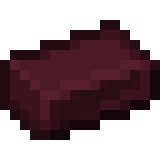
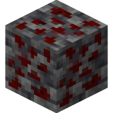
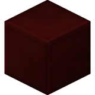
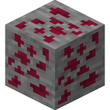
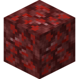
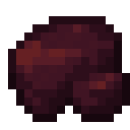

# Demonic Ingot

<figure><figcaption></figcaption></figure>

##  Identifier: <mark style="color:yellow;">**poke\_pfe:demonic\_ingot**</mark> 

##  Rarity: <mark style="color:yellow;">Common</mark> 

##  Stack Size: <mark style="color:yellow;">64</mark> 

##  Obtaining: 





<figure><figcaption>
Smelted in a <a href="https://minecraft.wiki/w/Furnace">Furnace</a>
</figcaption></figure> <figure><figcaption>
Smelted in a <a href="https://minecraft.wiki/w/Blast_Furnace">Blast Furnace</a>
</figcaption></figure>

<table><thead><tr><th>Input</th><th>Output</th><th data-type="number">Amount</th></tr></thead><tbody><tr><td> <a href="..\..\blocks\ores\deepslate-ores\deepslate-demonic-ore.md">Deepslate Demonic Ore</a></td><td> Demonic Ingot</td><td>1</td></tr></tbody></table>





<figure><figcaption>
Crafted in the <a href="https://minecraft.wiki/w/Crafting_Table">Crafting Table</a>
</figcaption></figure>

||
| :-: |
|  |

Items:

*   [Block of Demonic](..\..\blocks\ore-blocks\demonic-block.md)

Outputs:

* 9x  [Demonic Ingot](demonic-ingot.md)

Recipe can be unlocked with:

*  [Block of Demonic](..\..\blocks\ore-blocks\demonic-block.md)





<figure><figcaption>
Smelted in a <a href="https://minecraft.wiki/w/Furnace">Furnace</a>
</figcaption></figure> <figure><figcaption>
Smelted in a <a href="https://minecraft.wiki/w/Blast_Furnace">Blast Furnace</a>
</figcaption></figure>

<table><thead><tr><th>Input</th><th>Output</th><th data-type="number">Amount</th></tr></thead><tbody><tr><td> <a href="..\..\blocks\ores\stone-ores\demonic-ore.md">Demonic Ore</a></td><td> Demonic Ingot</td><td>1</td></tr></tbody></table>





<figure><figcaption>
Smelted in a <a href="https://minecraft.wiki/w/Furnace">Furnace</a>
</figcaption></figure> <figure><figcaption>
Smelted in a <a href="https://minecraft.wiki/w/Blast_Furnace">Blast Furnace</a>
</figcaption></figure>

<table><thead><tr><th>Input</th><th>Output</th><th data-type="number">Amount</th></tr></thead><tbody><tr><td> <a href="..\..\blocks\ores\nether-ores\nether-demonic-ore.md">Nether Demonic Ore</a></td><td> Demonic Ingot</td><td>1</td></tr></tbody></table>





<figure><figcaption>
Smelted in a <a href="https://minecraft.wiki/w/Furnace">Furnace</a>
</figcaption></figure> <figure><figcaption>
Smelted in a <a href="https://minecraft.wiki/w/Blast_Furnace">Blast Furnace</a>
</figcaption></figure>

<table><thead><tr><th>Input</th><th>Output</th><th data-type="number">Amount</th></tr></thead><tbody><tr><td> <a href="..\raw-ore\raw-demonic.md">Raw Demonic</a></td><td> Demonic Ingot</td><td>1</td></tr></tbody></table>





This page was generated automatically (NOT BY AI). there may be some broken links or improperly formatted information while I continue to develop this tool
