# Medic Ingot

<figure>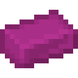<figcaption></figcaption></figure>

##  Identifier: <mark style="color:yellow;">**poke\_pfe:medic\_ingot**</mark> 

##  Rarity: <mark style="color:yellow;">Common</mark> 

##  Stack Size: <mark style="color:yellow;">64</mark> 

##  Obtaining: 





<figure><figcaption>
Crafted in the <a href="https://minecraft.wiki/w/Crafting_Table">Crafting Table</a>
</figcaption></figure>

||||
| :-: | :-: | :-: |
| 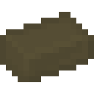 |  |  |
|  | 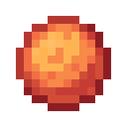 | 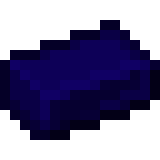 |
|  |  |  |

Items:

* 4x  [Godly Ingot](godly-ingot.md)

*   [Molten Slimeball](molten-slimeball.md)

* 4x  [Cobalt Ingot](cobalt-ingot.md)

Outputs:

*   [Medic Ingot](medic-ingot.md)

Recipe can be unlocked with:

*  [Godly Ingot](godly-ingot.md)

*  [Cobalt Ingot](cobalt-ingot.md)

*  [Cobalt Nugget](..\nuggets\cobalt-nugget.md)

* 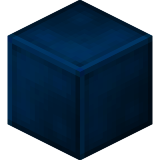 [Block of Cobalt](..\..\blocks\ore-blocks\cobalt-block.md)

* 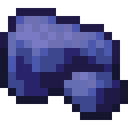 [Raw Cobalt](..\raw-ore\raw-cobalt.md)

* 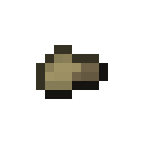 [Godly Nugget](..\nuggets\godly-nugget.md)

* 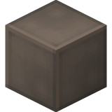 [Block of Godly](..\..\blocks\ore-blocks\godly-block.md)

* 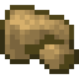 [Raw Godly](..\raw-ore\raw-godly.md)

* 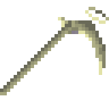 [Godly Scythe](..\..\weapons\scythes\godly-scythe.md)

* 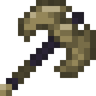 [Godly Battleaxe](..\..\weapons\battleaxes\godly-battlaxe.md)





<figure><figcaption>
Crafted in the <a href="https://minecraft.wiki/w/Crafting_Table">Crafting Table</a>
</figcaption></figure>

||
| :-: |
| 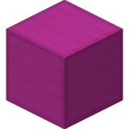 |

Items:

*   [Block of Medic](..\..\blocks\ore-blocks\medic-block.md)

Outputs:

*   [Medic Ingot](medic-ingot.md)

Recipe can be unlocked with:

*  [Block of Medic](..\..\blocks\ore-blocks\medic-block.md)





This page was generated automatically (NOT BY AI). there may be some broken links or improperly formatted information while I continue to develop this tool
