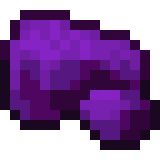
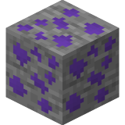

# Raw Galaxy

<figure><figcaption></figcaption></figure>

##  Identifier: <mark style="color:yellow;">**poke\_pfe:raw\_galaxy**</mark> 

##  Rarity: <mark style="color:yellow;">Common</mark> 

##  Stack Size: <mark style="color:yellow;">64</mark> 

##  Obtaining: 





<figure><figcaption>
Crafted in the <a href="https://minecraft.wiki/w/Crafting_Table">Crafting Table</a>
</figcaption></figure>

||
| :-: |
|  |

Items:

*   [Block of Raw Galaxy](..\..\blocks\raw-ore-blocks\block-of-raw-galaxy.md)

Outputs:

*   [Raw Galaxy](raw-galaxy.md)

Recipe can be unlocked with:

*  [Block of Raw Galaxy](..\..\blocks\raw-ore-blocks\block-of-raw-galaxy.md)




<figure><figcaption>
Obtained by Breaking a Block
</figcaption></figure>

<table><thead><tr><th>Block</th><th>Drop Amount</th><th data-type="checkbox">Fortune Works?</th></tr></thead><tbody><tr><td> <a href="..\..\blocks\ores\stone-ores\galaxy-ore.md">Galaxy Ore</a></td><td>4</td><td>true</td></tr></tbody></table>





This page was generated automatically (NOT BY AI). there may be some broken links or improperly formatted information while I continue to develop this tool
