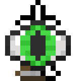
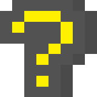
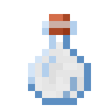
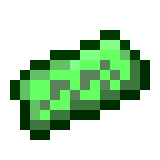
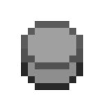
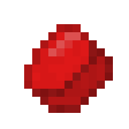

# Armor Stand Un-Hider

<figure><figcaption></figcaption></figure>

##  Identifier: <mark style="color:yellow;">**poke\_pfe:armor\_stand\_unhider**</mark> 

##  Rarity: <mark style="color:yellow;">Common</mark> 

##  Stack Size: <mark style="color:yellow;">1</mark> 

##  Obtaining: 





<figure><figcaption>
Crafted in the <a href="https://minecraft.wiki/w/Crafting_Table">Crafting Table</a>
</figcaption></figure>

||||
| :-: | :-: | :-: |
|  |  |  |
|  |  |  |
|  |  |  |

Items:

*   [Milk Bottle](..\..\items\foods\milk-bottle.md)

* 2x  [Electric Component](..\..\items\crafting-components\electric-component.md)

*   [Armor Stand](https://minecraft.wiki/w/Armor_Stand)

* 2x  [Plastic](..\..\items\crafting-components\plastic.md)

*   [Red Button](..\..\items\crafting-components\red-button.md)

Outputs:

* undefinedx  [Armor Stand Un-Hider](armor-stand-un-hider.md)

Recipe can be unlocked with:

*  [Milk Bottle](..\..\items\foods\milk-bottle.md)

*  [Armor Stand](https://minecraft.wiki/w/Armor_Stand)

*  [Electric Component](..\..\items\crafting-components\electric-component.md)

*  [Plastic](..\..\items\crafting-components\plastic.md)

*  [Red Button](..\..\items\crafting-components\red-button.md)





This page was generated automatically (NOT BY AI). there may be some broken links or improperly formatted information while I continue to develop this tool
