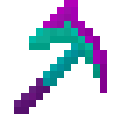
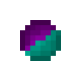
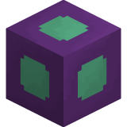
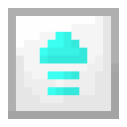
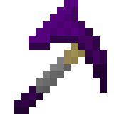
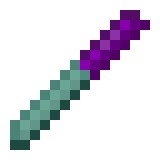
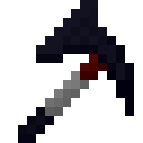
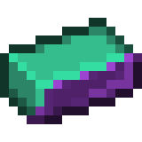
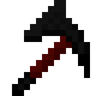
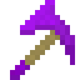

# Nebula Haxel

<figure><figcaption></figcaption></figure>

##  Identifier: <mark style="color:yellow;">**poke\_pfe:nebula\_haxel**</mark> 

##  Rarity: <mark style="color:yellow;">Epic</mark> 

##  Stack Size: <mark style="color:yellow;">1</mark> 

##  Attack Damage: <mark style="color:yellow;">23</mark> 

##  Obtaining: 





<figure><figcaption>
Crafted in the <a href="https://minecraft.wiki/w/Crafting_Table">Crafting Table</a>
</figcaption></figure>

||||
| :-: | :-: | :-: |
|  |  |  |
|  |  |  |
|  |  |  |

Items:

*   [Nebula Core](..\..\items\cores\nebula-core.md)

* 3x  [Block of Nebula](..\..\blocks\ore-blocks\block-of-nebula.md)

*   [Platinum Upgrade Core](..\..\items\cores\platinum-upgrade-core.md)

*   [Astral Haxel](astral-haxel.md)

*   [Nebula Stick](..\..\items\sticks\nebula_stick.md)

*   [Death Haxel](death-haxel.md)

Outputs:

*   [Nebula Haxel](nebula-haxel.md)

Recipe can be unlocked with:

*  [Nebula Ingot](..\..\items\ingots\nebula-ingot.md)

*  [Nebula Core](..\..\items\cores\nebula-core.md)

*  [Void Haxel](void-haxel.md)

*  [Galaxy Haxel](galaxy-haxel.md)

*  [Nebula Stick](..\..\items\sticks\nebula_stick.md)

*  [Platinum Upgrade Core](..\..\items\cores\platinum-upgrade-core.md)

*  [Block of Nebula](..\..\blocks\ore-blocks\block-of-nebula.md)

*  [Astral Haxel](astral-haxel.md)

*  [Death Haxel](death-haxel.md)





This page was generated automatically (NOT BY AI). there may be some broken links or improperly formatted information while I continue to develop this tool
