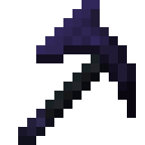
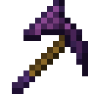
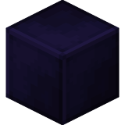
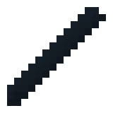
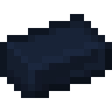

# Onyx Haxel

<figure><figcaption></figcaption></figure>

##  Identifier: <mark style="color:yellow;">**poke\_pfe:onyx\_haxel**</mark> 

##  Rarity: <mark style="color:yellow;">Common</mark> 

##  Stack Size: <mark style="color:yellow;">1</mark> 

##  Attack Damage: <mark style="color:yellow;">9</mark> 

##  Obtaining: 





<figure><figcaption>
Crafted in the <a href="https://minecraft.wiki/w/Crafting_Table">Crafting Table</a>
</figcaption></figure>

||||
| :-: | :-: | :-: |
|  |  |  |
|  |  |  |
|  |  |  |

Items:

*   [Creedite Haxel](amethyst-haxel.md)

* 2x  [Block of Onyx](..\..\blocks\ore-blocks\block-of-onyx.md)

*   [Nether Star](https://minecraft.wiki/w/Nether_Star)

* 2x  [Onyx Stick](..\..\items\sticks\onyx-shaft.md)

Outputs:

*   [Onyx Haxel](onyx-haxel.md)

Recipe can be unlocked with:

*  [Onyx Ingot](..\..\items\ingots\onyx-ingot.md)

*  [Creedite Haxel](amethyst-haxel.md)





This page was generated automatically (NOT BY AI). there may be some broken links or improperly formatted information while I continue to develop this tool
