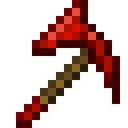
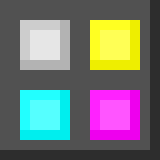

# Redstone Haxel

<figure><figcaption></figcaption></figure>

##  Identifier: <mark style="color:yellow;">**poke\_pfe:redstone\_haxel**</mark> 

##  Rarity: <mark style="color:yellow;">Common</mark> 

##  Stack Size: <mark style="color:yellow;">1</mark> 

##  Obtaining: 





<figure><figcaption>
Crafted in the <a href="https://minecraft.wiki/w/Crafting_Table">Crafting Table</a>
</figcaption></figure>

||||
| :-: | :-: | :-: |
|  |  |  |
|  |  |  |
|  |  |  |

Items:

* 4x  [Block of Redstone](https://minecraft.wiki/w/Block_of_Redstone)

*   [Stick](https://minecraft.wiki/w/Stick)

*   [Redstone Dust](https://minecraft.wiki/w/Redstone_Dust)

Outputs:

* undefinedx  [Redstone Haxel](redstone-haxel.md)

Recipe can be unlocked with:

*  [Redstone Dust](https://minecraft.wiki/w/Redstone_Dust)

*  [Block of Redstone](https://minecraft.wiki/w/Block_of_Redstone)





This page was generated automatically (NOT BY AI). there may be some broken links or improperly formatted information while I continue to develop this tool
