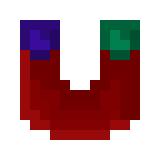
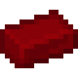
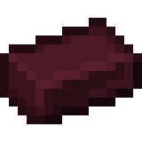
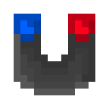
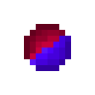
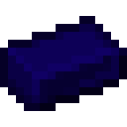

# Hostile Mob Magnet

<figure><figcaption></figcaption></figure>

##  Identifier: <mark style="color:yellow;">**poke\_pfe:hostile\_mob\_magnet**</mark> 

##  Rarity: <mark style="color:yellow;">Common</mark> 

##  Stack Size: <mark style="color:yellow;">1</mark> 

##  Obtaining: 





<figure><figcaption>
Crafted in the <a href="https://minecraft.wiki/w/Crafting_Table">Crafting Table</a>
</figcaption></figure>

||||
| :-: | :-: | :-: |
|  |  |  |
|  |  |  |
|  |  |  |

Items:

* 2x  [Hellish Ingot](..\..\items\ingots\hellish-ingot.md)

*   [Ender Pearl](https://minecraft.wiki/w/Ender_Pearl)

* 2x  [Demonic Ingot](..\..\items\ingots\demonic-ingot.md)

*   [Phantom Membrane](https://minecraft.wiki/w/Phantom_Membrane)

*   [Item Magnet](item-magnet.md)

*   [Nautilus Shell](https://minecraft.wiki/w/Nautilus_Shell)

*   [Ghast Tear](https://minecraft.wiki/w/Ghast_Tear)

Outputs:

*   [Hostile Mob Magnet](hostile-mob-magnet.md)

Recipe can be unlocked with:

*  [Demonic Ingot](..\..\items\ingots\demonic-ingot.md)

*  [Magnet Core](..\..\items\cores\magnet-core.md)

*  [Cobalt Ingot](..\..\items\ingots\cobalt-ingot.md)





This page was generated automatically (NOT BY AI). there may be some broken links or improperly formatted information while I continue to develop this tool
