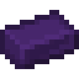
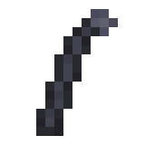
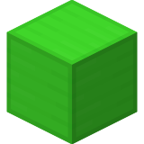
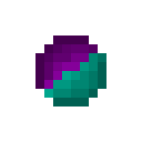
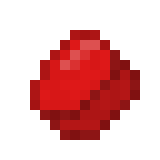
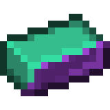

# Quantum Teleporter

<figure><figcaption></figcaption></figure>

##  Identifier: <mark style="color:yellow;">**poke\_pfe:quantum\_teleporter**</mark> 

##  Rarity: <mark style="color:yellow;">Epic</mark> 

##  Stack Size: <mark style="color:yellow;">64</mark> 

##  Obtaining: 





<figure><figcaption>
Crafted in the <a href="https://minecraft.wiki/w/Crafting_Table">Crafting Table</a>
</figcaption></figure>

||||
| :-: | :-: | :-: |
|  |  |  |
|  |  |  |
|  |  |  |

Items:

* 4x  [Galaxy Ingot](..\..\items\ingots\galaxy-ingot.md)

*   [Antenna](..\..\items\crafting-components\antenna.md)

* 2x  [Block of Radium](..\..\blocks\ore-blocks\block-of-radium.md)

*   [Nebula Core](..\..\items\cores\nebula-core.md)

*   [Red Button](..\..\items\crafting-components\red-button.md)

Outputs:

*   [Quantum Teleporter](quantum-teleporter.md)

Recipe can be unlocked with:

*  [Nebula Ingot](..\..\items\ingots\nebula-ingot.md)

*  [Galaxy Ingot](..\..\items\ingots\galaxy-ingot.md)

*  [Nebula Core](..\..\items\cores\nebula-core.md)

*  [Red Button](..\..\items\crafting-components\red-button.md)

*  [Antenna](..\..\items\crafting-components\antenna.md)





This page was generated automatically (NOT BY AI). there may be some broken links or improperly formatted information while I continue to develop this tool
