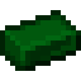
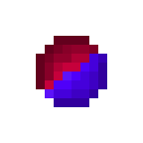

# XP Magnet

<figure><figcaption></figcaption></figure>

##  Identifier: <mark style="color:yellow;">**poke\_pfe:xp\_magnet**</mark> 

##  Rarity: <mark style="color:yellow;">Common</mark> 

##  Stack Size: <mark style="color:yellow;">1</mark> 

##  Obtaining: 





<figure><figcaption>
Crafted in the <a href="https://minecraft.wiki/w/Crafting_Table">Crafting Table</a>
</figcaption></figure>

||||
| :-: | :-: | :-: |
|  |  |  |
|  |  |  |
|  |  |  |

Items:

* 2x  [Gold Ingot](https://minecraft.wiki/w/Gold_Ingot)

* 5x  [Shade Ingot](..\..\items\ingots\shade-ingot.md)

*   [Magnet Core](..\..\items\cores\magnet-core.md)

Outputs:

* undefinedx  [XP Magnet](xp-magnet.md)

Recipe can be unlocked with:

*  [Shade Ingot](..\..\items\ingots\shade-ingot.md)

*  [Magnet Core](..\..\items\cores\magnet-core.md)

*  [Gold Ingot](https://minecraft.wiki/w/Gold_Ingot)





This page was generated automatically (NOT BY AI). there may be some broken links or improperly formatted information while I continue to develop this tool
