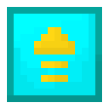

# End Upgrader

<figure><figcaption></figcaption></figure>

##  Identifier: <mark style="color:yellow;">**poke\_pfe:end\_upgrader**</mark> 

##  Rarity: <mark style="color:yellow;">Common</mark> 

##  Stack Size: <mark style="color:yellow;">1</mark> 

##  Obtaining: 





<figure><figcaption>
Crafted in the <a href="https://minecraft.wiki/w/Crafting_Table">Crafting Table</a>
</figcaption></figure>

||||
| :-: | :-: | :-: |
|  |  |  |
|  |  |  |
|  |  |  |

Items:

* 2x  [End Stone](https://minecraft.wiki/w/End_Stone)

*   [Chorus Fruit](https://minecraft.wiki/w/Chorus_Fruit)

* 2x  [Chorus Flower](https://minecraft.wiki/w/Chorus_Flower)

*   [Diamond Upgrade Core](..\..\items\cores\diamond-upgrade-core.md)

*   [End Rod](https://minecraft.wiki/w/End_Rod)

Outputs:

* undefinedx  [End Upgrader](end-upgrader.md)

Recipe can be unlocked with:

*  [End Rod](https://minecraft.wiki/w/End_Rod)

*  [End Stone](https://minecraft.wiki/w/End_Stone)

*  [Diamond Upgrade Core](..\..\items\cores\diamond-upgrade-core.md)

*  [Purpur Block](https://minecraft.wiki/w/Purpur_Block)

*  [End Stone Bricks](https://minecraft.wiki/w/End_Stone_Bricks)

*  [Chorus Flower](https://minecraft.wiki/w/Chorus_Flower)

*  [Chorus Fruit](https://minecraft.wiki/w/Chorus_Fruit)

*  [Purpur Stairs](https://minecraft.wiki/w/Purpur_Stairs)

*  [Shulker Shell](https://minecraft.wiki/w/Shulker_Shell)





This page was generated automatically (NOT BY AI). there may be some broken links or improperly formatted information while I continue to develop this tool
