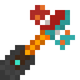
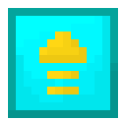

# Nether Upgrader

<figure><figcaption></figcaption></figure>

##  Identifier: <mark style="color:yellow;">**poke\_pfe:nether\_upgrader**</mark> 

##  Rarity: <mark style="color:yellow;">Common</mark> 

##  Stack Size: <mark style="color:yellow;">1</mark> 

##  Obtaining: 





<figure><figcaption>
Crafted in the <a href="https://minecraft.wiki/w/Crafting_Table">Crafting Table</a>
</figcaption></figure>

||||
| :-: | :-: | :-: |
|  |  |  |
|  |  |  |
|  |  |  |

Items:

*   [Crimson Fungus](https://minecraft.wiki/w/Crimson_Fungus)

*   [Magma Block](https://minecraft.wiki/w/Magma_Block)

*   [Soul Sand](https://minecraft.wiki/w/Soul_Sand)

*   [Diamond Upgrade Core](..\..\items\cores\diamond-upgrade-core.md)

*   [Warped Fungus](https://minecraft.wiki/w/Warped_Fungus)

*   [Blaze Rod](https://minecraft.wiki/w/Blaze_Rod)

*   [Basalt](https://minecraft.wiki/w/Basalt)

Outputs:

* undefinedx  [Nether Upgrader](nether-upgrader.md)

Recipe can be unlocked with:

*  [Magma Block](https://minecraft.wiki/w/Magma_Block)

*  [Warped Fungus](https://minecraft.wiki/w/Warped_Fungus)

*  [Diamond Upgrade Core](..\..\items\cores\diamond-upgrade-core.md)

*  [Crimson Fungus](https://minecraft.wiki/w/Crimson_Fungus)

*  [Blaze Rod](https://minecraft.wiki/w/Blaze_Rod)

*  [Soul Sand](https://minecraft.wiki/w/Soul_Sand)

*  [Netherrack](https://minecraft.wiki/w/Netherrack)

*  [Nether Bricks](https://minecraft.wiki/w/Nether_Bricks)

*  [Shroomlight](https://minecraft.wiki/w/Shroomlight)

*  [Glowstone](https://minecraft.wiki/w/Glowstone)

*  [Nether Wart](https://minecraft.wiki/w/Nether_Wart)

*  [Basalt](https://minecraft.wiki/w/Basalt)

*  [Smooth Basalt](https://minecraft.wiki/w/Smooth_Basalt)

*  [Nether Wart Block](https://minecraft.wiki/w/Nether_Wart_Block)





This page was generated automatically (NOT BY AI). there may be some broken links or improperly formatted information while I continue to develop this tool
