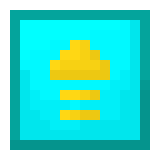

# Obsidian Depressor

<figure><figcaption></figcaption></figure>

##  Identifier: <mark style="color:yellow;">**poke\_pfe:obsidian\_depressor**</mark> 

##  Rarity: <mark style="color:yellow;">Common</mark> 

##  Stack Size: <mark style="color:yellow;">1</mark> 

##  Obtaining: 





<figure><figcaption>
Crafted in the <a href="https://minecraft.wiki/w/Crafting_Table">Crafting Table</a>
</figcaption></figure>

||||
| :-: | :-: | :-: |
|  |  |  |
|  |  |  |
|  |  |  |

Items:

* 2x  [Ghast Tear](https://minecraft.wiki/w/Ghast_Tear)

* 3x  [Crying Obsidian](https://minecraft.wiki/w/Crying_Obsidian)

* 2x  [Obsidian](https://minecraft.wiki/w/Obsidian)

*   [Diamond Upgrade Core](..\..\items\cores\diamond-upgrade-core.md)

*   [Stick](https://minecraft.wiki/w/Stick)

Outputs:

* undefinedx  [Obsidian Depressor](obsidian-depressor.md)

Recipe can be unlocked with:

*  [Obsidian](https://minecraft.wiki/w/Obsidian)

*  [Diamond Upgrade Core](..\..\items\cores\diamond-upgrade-core.md)





This page was generated automatically (NOT BY AI). there may be some broken links or improperly formatted information while I continue to develop this tool
