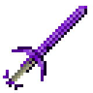
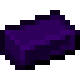
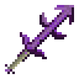
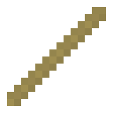
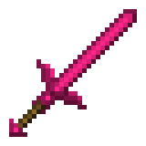

# Astral Claymore

<figure><figcaption></figcaption></figure>

##  Identifier: <mark style="color:yellow;">**poke\_pfe:astral\_claymore**</mark> 

##  Rarity: <mark style="color:yellow;">Common</mark> 

##  Stack Size: <mark style="color:yellow;">1</mark> 

##  Obtaining: 





<figure><figcaption>
Crafted in the <a href="https://minecraft.wiki/w/Crafting_Table">Crafting Table</a>
</figcaption></figure>

||||
| :-: | :-: | :-: |
|  |  |  |
|  |  |  |
|  |  |  |

Items:

*   [Platinum Upgrade Core](..\..\items\cores\platinum-upgrade-core.md)

* 2x  [Block of Astral](..\..\blocks\ore-blocks\block-of-astral.md)

* 2x  [Astral Ingot](..\..\items\ingots\astral-ingot.md)

*   [Galaxy Claymore](galaxy-claymore.md)

*   [Godly Stick](..\..\items\sticks\godly_stick.md)

*   [Medic Claymore](medic-claymore.md)

Outputs:

*   [Astral Claymore](astral-claymore.md)

Recipe can be unlocked with:

*  [Astral Ingot](..\..\items\ingots\astral-ingot.md)

*  [Block of Astral](..\..\blocks\ore-blocks\block-of-astral.md)

*  [Godly Stick](..\..\items\sticks\godly_stick.md)

*  [Platinum Upgrade Core](..\..\items\cores\platinum-upgrade-core.md)

*  [Medic Claymore](medic-claymore.md)

*  [Galaxy Claymore](galaxy-claymore.md)





This page was generated automatically (NOT BY AI). there may be some broken links or improperly formatted information while I continue to develop this tool
